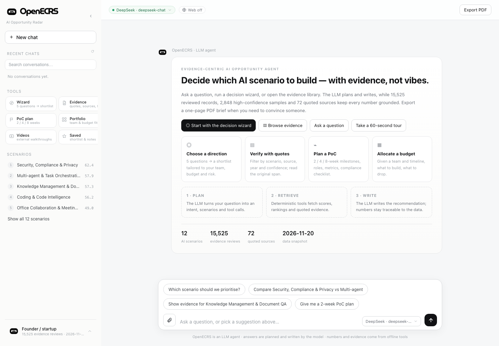
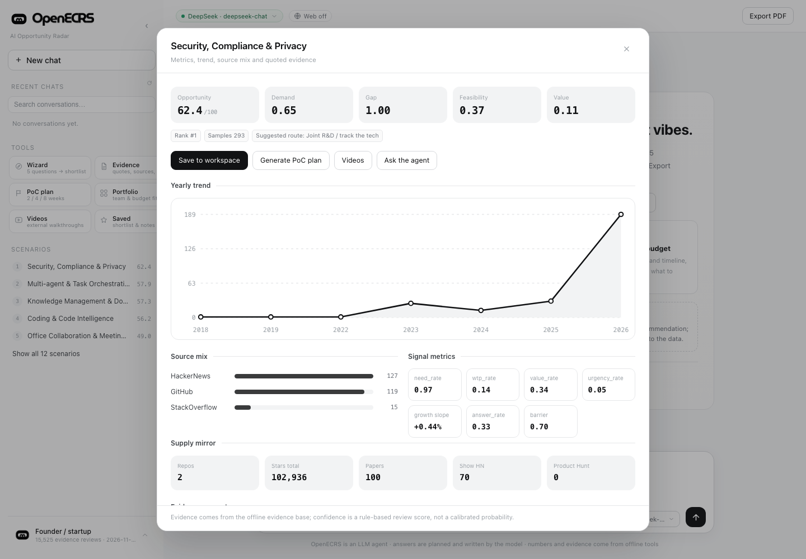
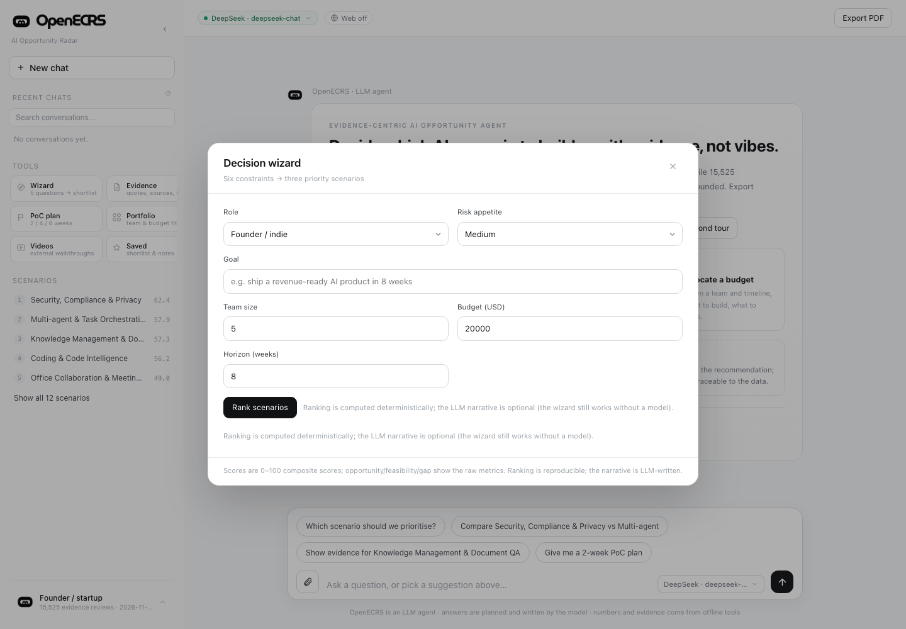
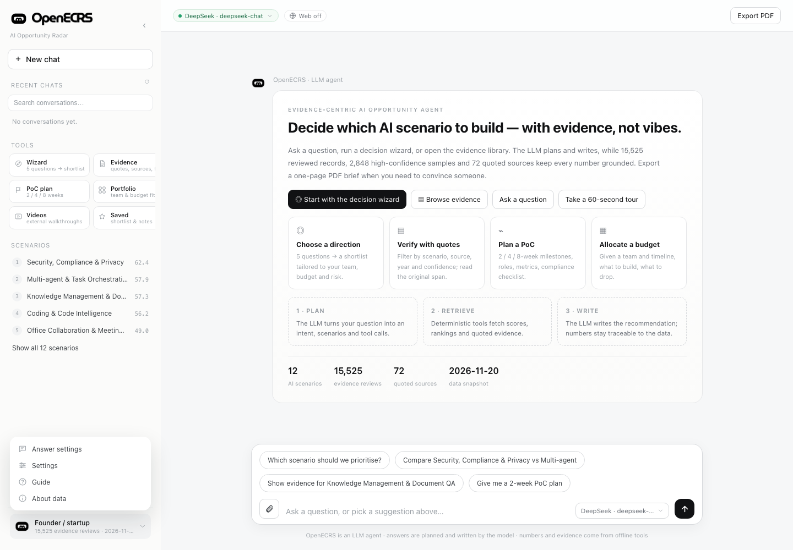
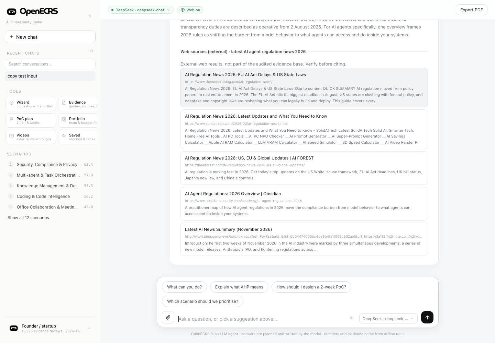

<p align="center">
  
</p>

<p align="center"><b>Open Evidence-Centric Recommendation System · 证据驱动机会推荐智能体</b><br>
把公开的 AI 工具信号，变成可核查、可排序、可执行的产品机会判断。</p>

<p align="center">
  
  
  
  
</p>

<p align="center">
  <a href="README.md">English</a> ·
  <a href="docs/screenshots/hero-en.png">界面截图</a> ·
  <a href="skills/openecrs_agent.md">Agent Skill</a> ·
  <a href="#快速开始">快速开始</a> ·
  <a href="#http-api">API</a>
</p>

---

## OpenECRS 是什么

大多数“AI 机会清单”只是观点。OpenECRS 是一个真正可运行的 Agent 系统，专注回答一个更窄、更有用的问题：

> **哪个 AI 应用场景值得做？为什么？下一步做什么？**

它由三层组成：

1. **证据库**：来自 Hacker News、GitHub、arXiv、Stack Overflow、Product Hunt 的 52,007 条公开记录，清洗为 45,306 条，形成 15,525 个需求单元、2,848 条高置信场景样本和 72 条可引用原文。
2. **确定性工具**：场景评分、排名、对比、证据检索、PoC 计划、预算组合、年度趋势等，全部由离线工具计算。
3. **LLM Agent**：规划回答、调用工具，并撰写一句话建议、说明、行动建议与风险；支持 English / 中文 / 日本語 / Español。

**LLM 是必需的。** 未配置模型时智能体拒绝对话；数字、排名与原文证据永远来自工具，而不是模型。

---

## 核心特性

- **必须有 LLM，无规则兜底**：OpenAI 兼容 API，或本地 Qwen2.5-3B + LoRA 适配器。
- **真正的 Agent 循环**：`规划 → 工具 → 作答`，每轮两次模型调用，界面展示 Agent 过程。
- **从机制上保证有据可查**：12 个场景、72 条原文，证据附来源、年份、置信度与四门标记。
- **六个实际工具**：决策向导、证据浏览器、PoC 计划、组合预算、场景深潜、收藏工作区，外加上下文视频搜索。
- **一页纸 PDF 建议书**：建议、评分卡、证据摘录、行动计划、风险与口径局限。
- **多语言 + 角色化**：默认跟随系统，支持 English / 中文 / 日本語 / Español；每次请求锁定输出语言，切换后不会回退成中文。
- **历史对话保留**：刷新页面或重启服务后恢复，支持搜索、重命名、删除。
- **干净可折叠界面**：官方 Logo、响应式侧边栏、模型切换、设置分为「模型 / 偏好设置」。
- **可选联网搜索**：独立开关（默认关闭），用于最新新闻/竞品/监管；优先本地 SearXNG，Bing 兜底；结果标注外部，不混入评分。
- **文档/图片上传**：支持 PDF/DOCX/TXT/MD/CSV 与图片；短文档直接进上下文，长文档自动分片检索，图片用 Tesseract OCR；扫描 PDF 自动 OCR。
- **更长的上下文记忆**：作答阶段会带上最近多轮对话，会话保留 24 轮，文档上下文扩展到 28k 字符。
- **默认完全本地运行**：无需构建、无 CDN、无遥测；只向你配置的 LLM 端点发请求（开启联网搜索时，搜索词也会发给 Bing）。

### 设计原则

- **默认有据可查**：无法回溯到工具结果的数字，不进入回答。
- **LLM 负责语言，代码负责事实**：模型规划与撰写，评分/排名/原文由确定性代码提供。
- **不确定性要明说**：每份建议书都写明校准、样本与来源偏差。
- **本地优先**：单个 Python 进程，无构建、无遥测、无 CDN。

---

## 界面截图

| 首屏工作区 | 场景深潜 |
|---|---|
|  |  |

| 决策向导 | 侧边栏与个人信息菜单 | 联网搜索 |
|---|---|---|
|  |  |

| 联网搜索（默认关闭） |
|---|
|  |

更多截图见 [`docs/screenshots/`](docs/screenshots/)，示例 PDF 见 [`docs/examples/`](docs/examples/)。

---

## 能做什么

| 能力 | 产出 |
|---|---|
| **决策向导** | 6 个约束（角色、目标、团队、预算、周期、风险）→ 3 个场景短名单，确定性评分 + 适配理由 + 风险点；LLM 补充叙述。 |
| **证据浏览器** | 按场景/来源/年份/置信度/正反证据筛选 72 条原文，直接读原句并打开来源。 |
| **PoC 计划** | 2 / 4 / 8 周里程碑，含交付物、退出标准、角色、成功指标、数据合规清单与启发式人力/成本。 |
| **组合预算** | 给定团队、周期、预算：先验证哪个、构建哪个、放弃哪个。 |
| **场景深潜** | 机会评分卡、年度趋势、来源结构、供给信号（仓库/Star/论文/Show HN）、证据摘录。 |
| **收藏工作区** | 收藏场景、写备注，并让 Agent 对比收藏清单。 |
| **视频搜索** | 按场景生成 YouTube / B站 外部搜索链接（明确标注外部内容、非证据库）。 |
| **联网搜索（可选）** | 一个开关查最新新闻/竞品/监管；优先本地 SearXNG，Bing 兜底；标注外部，不参与评分。 |
| **文档/图片上传** | PDF/DOCX/TXT/MD/CSV/图片；4000 token 阈值自动 light/RAG 路由，图片 OCR，片段注入对话。 |
| **对话** | 自然语言提问：排名、场景分析、对比、证据、PoC、视频、寒暄等。 |
| **PDF 建议书** | 一页 A4：建议、评分卡、证据、行动、风险与口径说明。 |

所有估算均标注 **heuristic（启发式）**，不会当作市场事实。

---

## 架构

```text
┌─────────────────────────────┐
│  用户问题 / 界面操作          │
└──────────────┬──────────────┘
               │  角色 · 语言
┌──────────────▼──────────────┐
│  规划器（LLM 第 1 次）        │  严格 JSON：意图、场景、工具
└──────────────┬──────────────┘
               │
┌──────────────▼──────────────┐
│  确定性工具层                 │  catalog · ranking · scenario
│                              │  compare · evidence · search · videos
└──────────────┬──────────────┘
               │  有据可查的 JSON
┌──────────────▼──────────────┐
│  作答器（LLM 第 2 次）        │  建议 · 说明 · 行动 · 风险
└──────────────┬──────────────┘
               │
┌──────────────▼──────────────┐
│  运行时装配                   │  指标 · 排名 · 证据 · 过程记录
│                              │  对话卡片 · PDF · 历史
└─────────────────────────────┘
```

数据真实性由运行时保证。模型只负责规划与措辞，不得编造数字、场景、来源或链接。

---

## 快速开始

```bash
# Python 3.11+（已在 3.14 / macOS 验证）
pip install -r requirements.txt          # pandas 只在重建 data.json 时需要

python code/agent_app.py --open          # -> http://127.0.0.1:8765
```

macOS 也可以双击 **`openecrs.command`**。

首次启动后打开 **设置**，二选一；界面、回答与 PDF 的语言在 **设置 → 偏好设置** 中切换。

### 方式 A — OpenAI 兼容 API（推荐）

| 服务 | Base URL | 模型示例 |
|---|---|---|
| DeepSeek | `https://api.deepseek.com/v1` | `deepseek-chat` |
| OpenAI | `https://api.openai.com/v1` | `gpt-4o-mini` |
| Moonshot | `https://api.moonshot.cn/v1` | `moonshot-v1-8k` |
| 通义 DashScope 兼容模式 | `https://dashscope.aliyuncs.com/compatible-mode/v1` | `qwen-plus` |
| 本地 Ollama | `http://127.0.0.1:11434/v1` | 任意本地模型名 |

填入 Key → **测试连接** → **保存**。Key 仅保存在 `outputs/agent_ui/settings.json`（权限 `0600`），只发送到你配置的端点；也支持 `DEEPSEEK_API_KEY`、`OPENAI_API_KEY`、`LLM_API_KEY`、`LLM_BASE_URL`、`LLM_MODEL` 环境变量。

### 可选：启用项目内置 SearXNG 联网搜索（无需 Docker）

SearXNG 源码已内置在 `vendor/searxng/`（AGPL-3.0），原生启动：

```bash
./scripts/run_searxng.sh        # 自动创建 .searxng-venv、安装依赖、监听 http://127.0.0.1:8889
# 验证：curl 'http://127.0.0.1:8889/search?q=test&format=json'
```

需要 Python 3.11+，首次安装依赖需要网络。引擎/端口/密钥在 `mcp/searxng/settings.yml` 配置，不依赖 Docker。

`agent_web.py` 的调用顺序：**新闻 RSS**（Google News / Bing News，适合最新/监管类问题）→ **内置 SearXNG JSON**（8889，回退 8888）→ **Bing HTML**；结果会抓取网页正文清洗为文本，卡片展示完整链接。可用 `SEARXNG_URL` 指向其他实例；可选 MCP 配置见 `mcp/`。

### 方式 B — 本地微调模型

```bash
pip install -r requirements-lora.txt
# 将 Qwen2.5-3B-Instruct 权重放入 models/Qwen2.5-3B-Instruct
# 桌面包内附带试训适配器 outputs/lora/adapter_pilot（GitHub 仓库不含）
```

设置 → 模型 → **本地微调**，填写基座与适配器路径，测试并保存。CPU 可运行但较慢，推荐 GPU。该适配器由 160 条伪标签、24 步试训得到，用于验证训练/推理链路，不代表准确率。

### 多模型配置与一键切换

顶栏和输入框右侧都有模型切换入口。每个配置保存自己的后端、Key/路径和显示名；切换后对下一句生效，可在同一菜单中新增、编辑或删除。

---

## 语言与角色

- **语言**：跟随系统（默认）、English、中文、日本語、Español。“跟随系统”读取 `navigator.language`（zh/ja/es，否则英文），选择会本地记忆，并随每次请求发送；prompt 会强制输出语言，不受历史对话或数据语言影响。
- **角色**：创业、大厂、投资、产品。角色改变的是规划优先级与口吻（可行性/MVP、合规/规模化、市场/竞争、路线图/指标），不改变数字。
- 两者都在 **设置 → 偏好设置**；底部个人信息菜单提供 **回答设置** 快捷入口。

---

## HTTP API

```bash
curl -s http://127.0.0.1:8765/api/chat \
  -H 'Content-Type: application/json' \
  -d '{"session":"demo","message":"哪个场景最值得优先做？","lang":"zh","role":"founder"}'

curl -s -X POST http://127.0.0.1:8765/api/pdf \
  -H 'Content-Type: application/json' \
  -d '{"session":"demo","lang":"zh"}' -o 建议书.pdf
```

| 端点 | 方法 | 说明 |
|---|---|---|
| `/api/chat` | POST | `{session, message, lang, role, web_search, attachment_id}` → 建议、说明、指标、排名、对比、证据、视频、行动、风险、引擎信息、Agent 过程 |
| `/api/pdf` | POST | `{session, lang}` → `application/pdf` 建议书 |
| `/api/settings` | GET/POST | 读取（Key 脱敏）/ 创建或更新模型配置 |
| `/api/active` | POST | 切换当前模型配置 |
| `/api/test` | POST | 测试当前后端 |
| `/api/health` | GET | 服务、LLM 就绪状态、数据与 PDF 状态 |
| `/api/data` | GET | 界面使用的紧凑数据集 |
| `/api/evidence` | GET | 证据筛选：`scenario`、`source`、`year`、`min_confidence`、`kind`、`q`、`limit` |
| `/api/scenario_detail` | GET | 评分卡、趋势、来源结构、供给、证据 |
| `/api/videos` | GET | YouTube / B站外部搜索链接 |
| `/api/wizard` | POST | 决策向导短名单 + 可选叙述 |
| `/api/poc` | POST | PoC 计划骨架 + 可选叙述 |
| `/api/portfolio` | POST | 团队/预算组合推荐 |
| `/api/workspace` | GET/POST | 收藏场景与备注 |
| `/api/upload` | POST | `{name, data(base64)}` → 文档/图片解析元数据（`id`、`mode`、`tokens`、`preview`） |
| `/api/sessions` | GET | 历史对话列表（可选 `q`） |
| `/api/session` | GET/DELETE | 读取或删除单个对话 |
| `/api/session/rename` | POST | 重命名对话 |

未配置 LLM 时 `/api/chat` 返回 **HTTP 428** 与 `{"code":"llm_required"}`，绝不回退到模板。

---

## 证据库与方法

数据快照：**2026-11-20**。

| 项目 | 数值 |
|---|---|
| 原始记录 | 52,007 |
| 清洗记录 | 45,306 |
| 需求单元 | 15,525 |
| 高置信场景样本 | 2,848（18.34%） |
| 证据审查 | 15,525 |
| 四门机会 | 162 |
| 场景数 | 12 |
| 内置原文证据 | 72 |

**机会总分** = 需求强度 **45%** + 供给缺口 **25%** + 技术可行性 **18%** + 商业价值 **12%**（AHP 权重，CR = 0.0002）。

机会总分前五：安全合规与隐私 **62.41**；多智能体与任务编排 **57.86**；知识管理与文档问答 **57.28**；编程与代码智能 **56.20**；办公协作与会议效率 **48.98**。

产出证据库的采集、清洗、弱监督、评分与证据审查流水线不在本仓库内；本仓库包含运行时与重建 `data.json` + `insights.json` 所需的对账数据。

### 口径与局限

- 场景标签来自弱监督，不是人工全量标注。
- 来源偏差：Hacker News / GitHub 占比较高，不能当作真实市场占比。
- 供给成熟度用仓库/Star/论文/Show HN 近似；付费意愿来自文本信号。
- 规则置信度**未经人工校准**（无金标），结论应视为待真实用户验证的假设。
- PoC 人力/成本为**启发式估算**，已明确标注。
- 视频是外部搜索链接，不是证据。
- 同一问题不同轮次措辞可能不同；评分、排名与原文是确定性的。

---

## 目录结构

```text
OpenECRS/
├─ code/
│  ├─ agent_app.py          # HTTP 服务、静态界面与 API
│  ├─ agent_core.py         # 规划 → 工具 → 作答、会话、过程记录
│  ├─ agent_prompts.py      # Agent Skill → 多语言规划/作答 prompt
│  ├─ agent_tools.py        # 场景数据、排名、对比、证据检索
│  ├─ agent_features.py     # 向导 / PoC / 组合算法与叙述 prompt
│  ├─ agent_insights.py     # 证据索引、年度趋势、视频链接
│  ├─ agent_web.py          # 可选 SearXNG/Bing 联网搜索（外部、默认关闭）
│  ├─ agent_uploads.py      # 文档/图片解析 + light/RAG-lite 路由
│  ├─ agent_settings.py     # 模型配置、就绪检查、旧配置迁移
│  ├─ agent_providers.py    # 后端解析与连通性测试
│  ├─ agent_llm.py          # OpenAI 兼容 HTTP 客户端
│  ├─ agent_local.py        # 本地 Qwen2.5 + LoRA 后端（可选）
│  ├─ agent_pdf.py          # A4 建议书模板与本地 Chromium 渲染
│  ├─ agent_ui.html         # 单文件界面（无构建）
│  ├─ agent_ui_features.js  # 功能面板（向导、证据、PoC、组合等）
│  ├─ agent_ui_features.css
│  ├─ agent_ui_data.py      # 重建 data.json + insights.json
│  ├─ assets/               # 官方 Logo 图标 / 字标 / favicon
│  └─ test_*.py             # 98 项测试
├─ skills/openecrs_agent.md # 人类可读的 Agent Skill 定义
├─ mcp/                    # SearXNG 设置与可选 MCP 配置
├─ vendor/searxng/         # 内置 SearXNG 源码（AGPL-3.0，无需 Docker）
├─ scripts/run_searxng.sh  # 原生 SearXNG 启动脚本
├─ prompts/                # 联网/全局 prompt 片段
├─ uploads/                # 用户上传（gitignore）
├─ outputs/
│  ├─ agent_ui/data.json
│  ├─ agent_ui/insights.json
│  └─ tables/
├─ docs/screenshots/ · docs/examples/
├─ openecrs.command · requirements*.txt
└─ README.md · README.zh-CN.md
```

---

## 自检

```bash
cd code
python -m unittest test_agent_tools test_agent_core test_agent_http test_agent_features test_agent_insights test_agent_web test_agent_uploads -v
# 98 项
```

覆盖：离线工具、规划/作答校验（假 provider，含寒暄、视频路由、角色）、未配置 LLM 拒绝路径、HTTP 设置/测试/对话/模型切换/功能端点（mock OpenAI 端点）、向导/PoC/组合算法、洞察聚合、历史持久化，以及有浏览器时的 PDF 导出。

---

## 安全与隐私

- API Key 与本地模型路径仅保存在 `outputs/agent_ui/settings.json`（权限 `0600`），不会提交到仓库。
- 历史对话、收藏、PDF 与日志保存在 `outputs/agent_ui/` 下，并已被 gitignore。
- 无遥测、无分析、无 CDN；唯一外部请求是发往你配置的 LLM 端点；开启**联网搜索**时，搜索词会发给本地 SearXNG（不可用时回退 Bing）。上传文件保存在 `uploads/`，已被 gitignore。
- 界面由本机 Python HTTP 服务提供；不要在没有鉴权的情况下暴露到不可信网络。

---

## 常见问题

**必须配置 API Key 吗？** 是。OpenECRS 是 LLM 必需的智能体，未配置模型时接口返回 HTTP 428；可用 OpenAI 兼容 API，或本地 Qwen2.5 + LoRA。

**数据是实时的吗？** 不是。证据快照固定为 2026-11-20，需要重跑上游流水线才能刷新。

**模型会拿到我的 Key 吗？** 不会。Key 只保存在本地 Python 进程中，仅发送到你配置的端点。

**能离线使用吗？** 界面与工具可离线；LLM 本身必须可达（本地 Ollama/Qwen 或在线 API）。

**为什么估算都写“heuristic”？** 人力/成本区间是规划辅助，不是实测市场数据，需自行验证。

**为什么有些置信度很低？** 证据审查是规则影子审查、无人工金标；低置信度会如实展示，而不是隐藏。

**上下文有多长？** 最近 24 轮对话、短文档全文或长文档 top-6 片段、最多 6 条证据、最多 5 条网页结果（含正文摘录）；作答最多 1500 tokens。

**什么时候该开联网搜索？** 只有答案依赖 2026-11-20 快照之后的信息（新闻、竞品、监管、融资）时才开；纯证据/审计/离线场景保持关闭，网页结果不参与评分。

**上传的文件会去哪？** 保存在本地 `./uploads`（已 gitignore）。短文档直接进上下文；长文档分片，只把相关片段发给 LLM；扫描 PDF 会 OCR，图片用 Tesseract。除发给 LLM 端点的上下文外，文件不会离开本机。

---

## 许可与署名

本仓库代码供研究与评估使用；引用的第三方数据片段版权归原作者与平台所有。OpenECRS 是独立项目，与所列模型服务商无隶属关系。
